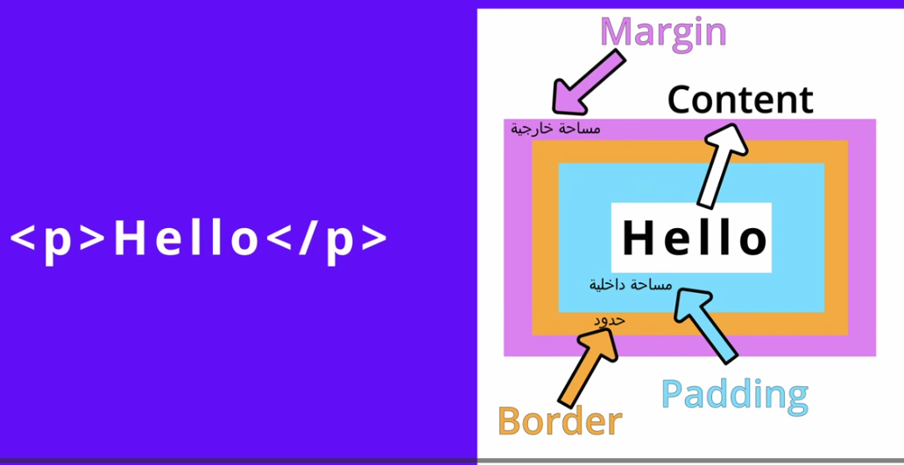

# 3 box model

## English words

- border
- margin
- padding
- pixel
- top
- right
- bottom
- left
- box-sizing

## topics

1. border
2. width,height
3. margin
4. padding
5. percentage idea
6. fit-content
7. min-content
8. max-content
9. min-width
10. max-width

## Explain

1. each element h1,p is a box, content and outsides
2. create h1 and inspect box 
- [border]
3. border سور البيت 
4. border solid
5. border solid 
6. border solid 10px red;
7. border -top -bottom -left -right
8. shorthand 1px sold red;
9. dotted dashed
10. border-radius (beautiful than sharped one)
11. 2 values (top-left,bottom-right)(top-right,bottom-left)
12. 4 values like clockwise
13. circel? 50%
14. [percentage] of parent

- [width,height]
  - width = 100px;
    - width = 100% = auto = screen wide
    - width % of parent
      - add 2 divs inside each other
  - height 100px
    - height = 50% of parent
    - height w/o content 2 divs

- [padding]
  - top,button,left,right

- [margin]
  - center by make left pixels=right pixels
  - if size=30%?
  - auto
    - margin 0 auto
    - only horizontal
    - not related to content
    - no padding auto

- [Percentage]
  - width
    - 100%==auto
    - depends on screen width
    - parent affect (add fix num to parent)
  
  - height
    - depends on content
    - make body empty, no height
    - parent affect (add fix/pernetage num to parent)

- width = fit-content
- width = min-content ->  max word length
  - type words have different length
- width = max-content -> text one line with scroll

- min-max
- create 2 divs background, [width,m-width], width:900px, lorem
- max-width (max width this element can reach)
  - content displayed on different screens
  - 0 to max(after max no increase) before decrease
    - when narrow:
      - fixed length will scroll
      - max won't scroll
- min-width (lowest width this element can start with)
  - min width to start with, increase with page increase,
  - if content length > current page width => scroll

- max-height (max height where effect can apply on content)
  - from 0 to max
  - if content > height, apply on height
- min-height
  - min height to start affecting with, and increase as content increase
  - if content > height, apply on content

## task

- add border,padding and margin to pillars and countries

- index
  - remove one br in hajj video and add margin to video
- task
  - add margin for all audio tags [only] and remove br
